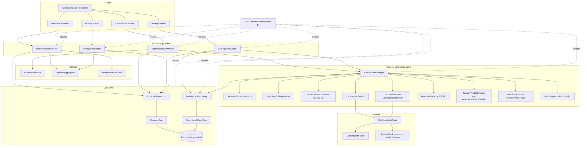
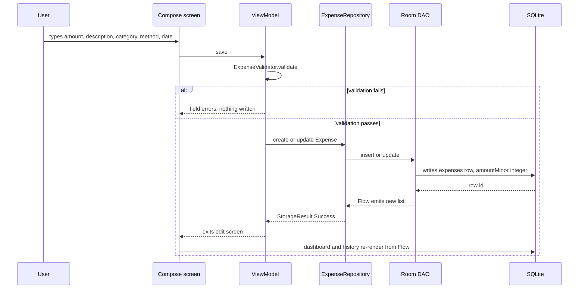
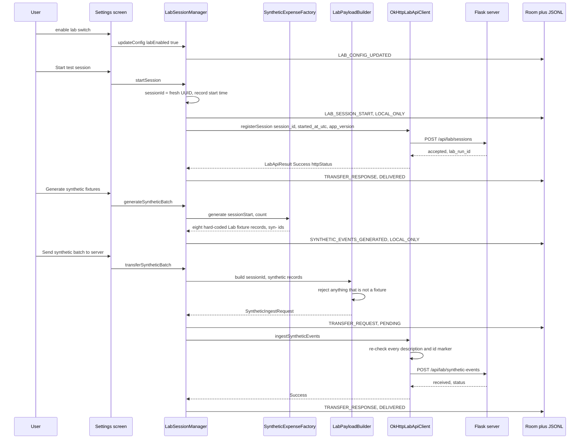
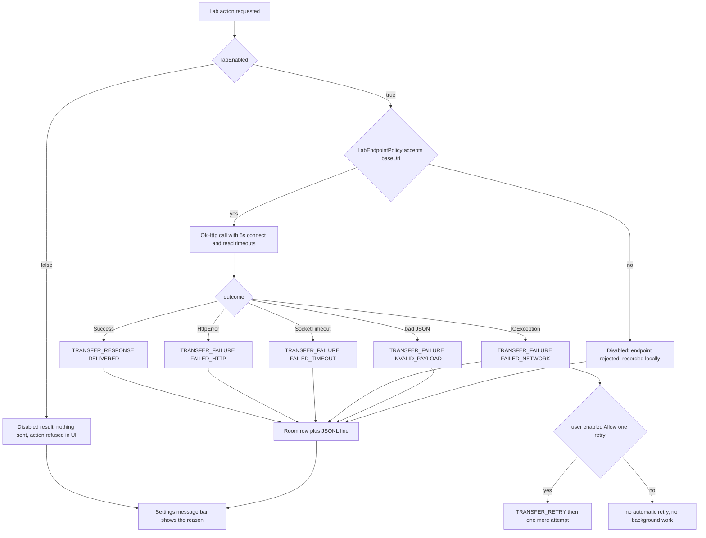
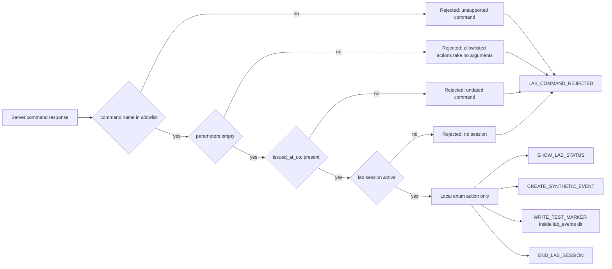

# Architecture

DailySpend is a single-module Android app split by package into four cooperating areas: the
everyday tracker (UI + domain + data), the dependency graph, the opt-in security lab, and the
network client for the lab server. The lab and the network client have no path into the expense
table, and the expense table has no path into the network client.

## 1. Layering

The `ui/*ViewModel` classes never touch OkHttp or files directly; only `LabSessionManager` reaches
the network layer, and only `ExpenseRepository` reaches the `expenses` table.

## 2. Ordinary tracker data flow

Observable reads are `Flow`-based (`observeAll`, `observeInRange`, `observeRecent`, `observeCount`),
so a write anywhere in the app refreshes every subscribed screen without manual invalidation.
Failures are returned as `StorageResult.Failure(reason)` and rendered as a message bar; no database
error propagates as an exception into composition.

## 3. Lab session, happy path

## 4. Failure and offline paths

Every branch produces a local record and a human-readable summary; none throws at the UI layer, and
none schedules work after the screen is closed.

## 5. Command allowlist gate

The parser maps the wire string onto the `LabCommand` enum and then executes that enum value only.
Server text is never eval-ed, never passed to a shell, never used as a path outside the lab
directory, and never loaded as code.

## 6. Artefact map

| Artefact | Written by | Contents | Notes for acquisition |
| --- | --- | --- | --- |
| `databases/daily_spend.db`, table `expenses` | `ExpenseDao` | user-entered amounts (minor units), category, description, payment method, expense date, created/updated timestamps | indexed on `expenseDate` and `category`; deleted only by the user or by clearing app data |
| `databases/daily_spend.db`, table `security_lab_events` | `LabSessionManager` via `SecurityLabRepository` | session id, event type, UTC epoch millis, payload JSON, delivery status | indexed on `sessionId` and `eventType`; only the lab writes here |
| `files/lab_events/lab_forensic_events.jsonl` | `ForensicEventLog` | one JSON object per line: event id, session id, event type, ISO-8601 UTC timestamp, `synthetic` flag, request status, truncated detail | capped at 500 records and 256 KB, one rotation file `lab_forensic_events.prev.jsonl` |
| `files/lab_events/lab_test_marker.txt` | `WRITE_TEST_MARKER` allowlisted command | session id, UTC timestamp, `synthetic=true` | only ever written inside the lab directory |
| Notification shade, channel `daily_spend_security_lab` | `AndroidLabResultNotifier` | one DailySpend-owned notification per *Run Security Test* press: title, result text, fixture id, HTTP status | ephemeral and user-visible; `adb shell dumpsys notification --noredact` lists it while un-dismissed. The archived `SECURITY_TEST_NOTIFICATION` row records the same text and whether the system accepted it. No `NotificationListenerService` exists, so no other app's notifications are readable by this app |
| `shared_prefs/daily_spend_lab.xml` | `LabSettingsStoreImpl` | `lab_enabled`, `lab_base_url`, `lab_connect_timeout`, `lab_read_timeout`, `lab_retry_enabled`, `lab_max_retries` | defaults come from `BuildConfig`, so a release build has an empty base URL and lab off |
| Logcat | `AndroidLabLogger` | tag `DailySpendLab`; each line starts with the event type, then `session=<id>` and key-value detail such as `syntheticOnly=true` | ephemeral, not persisted by the app |

Both backup rule files list exactly one path, `daily_spend.db`, so the `files/lab_events` folder
never travels with an auto backup or a device transfer while the user's expense database does (see
`res/xml/backup_rules.xml` and `res/xml/data_extraction_rules.xml`).

## 7. Design choices worth knowing

- **Hand-written DI (`di/AppContainer.kt`)** instead of Hilt: a forensic examiner is expected to read
  every artefact the app produces, so the graph is explicit and small.
- **OkHttp without Retrofit**: five endpoints, all typed by hand, so there is no generated code and
  every request is visible in one file.
- **Sealed results everywhere** (`StorageResult`, `LabApiResult`, `CommandDecision`,
  `LabEndpointPolicy.Decision`): the UI cannot accidentally swallow an exception, and the compiler
  forces each network outcome to be handled.
- **A distinct `SyntheticExpenseRecord` type** rather than reusing `Expense`: the payload builder
  literally cannot be called with a real row.
- **Room schema is committed** to `app/schemas/.../1.json`, and destructive migration is off, so a
  database is never silently rebuilt during an exercise.
